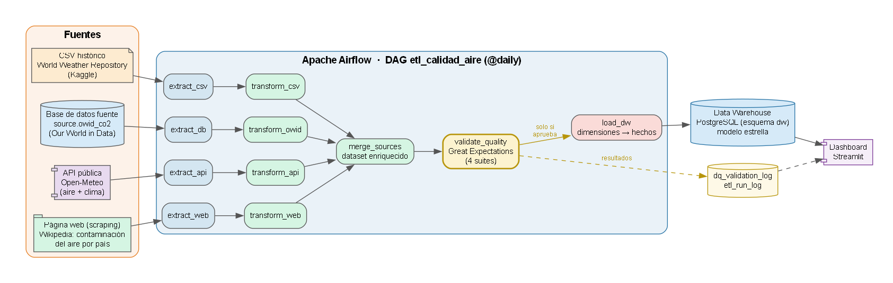
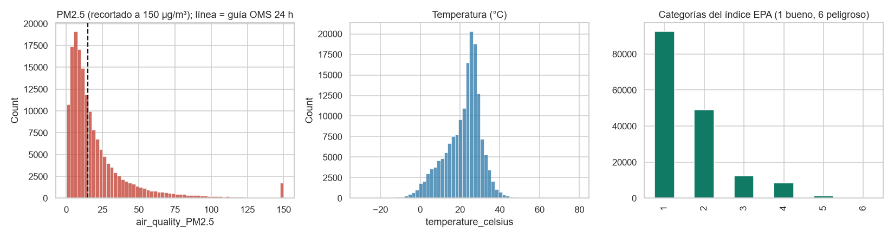
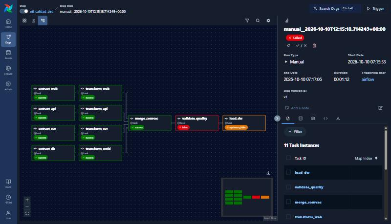
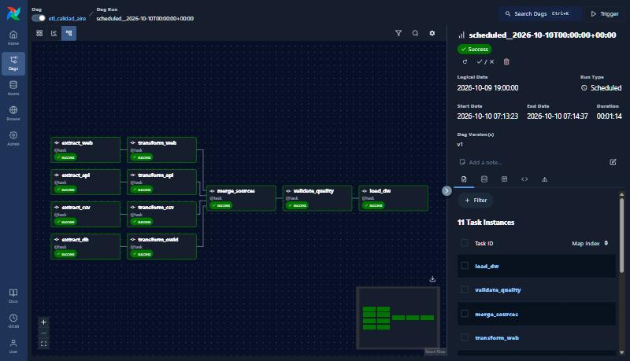
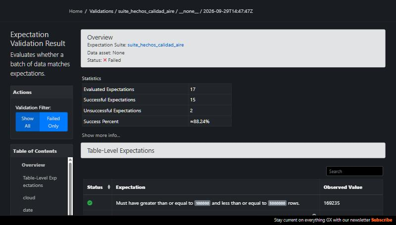
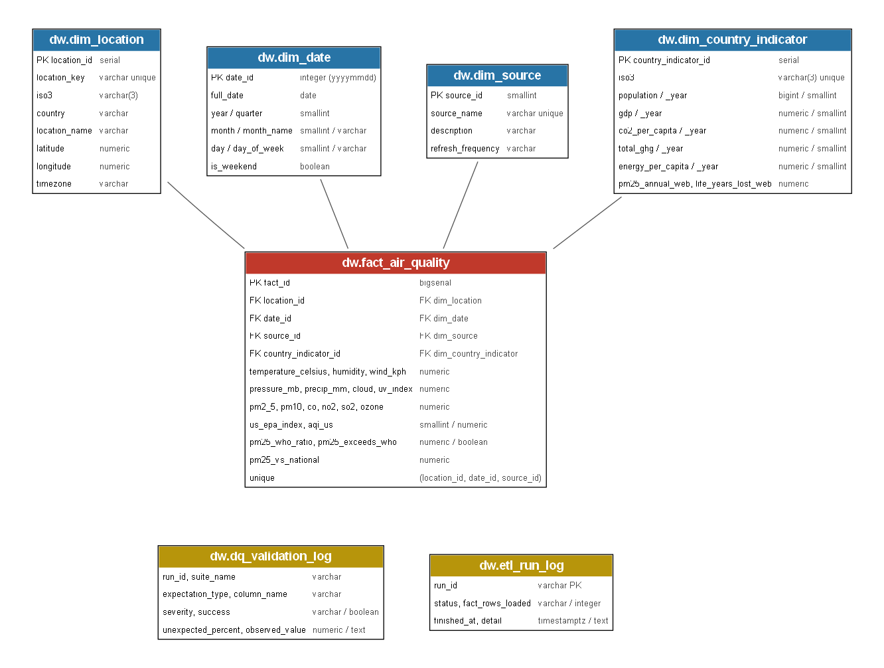
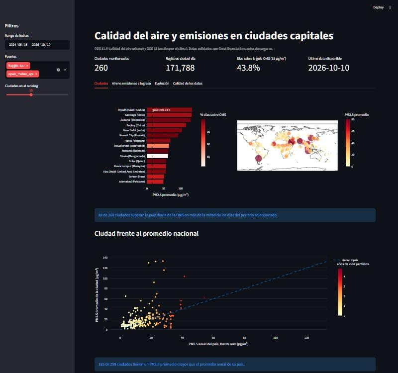
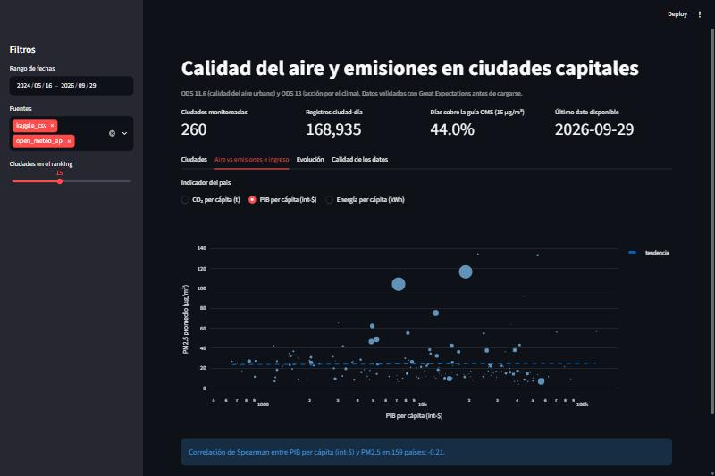
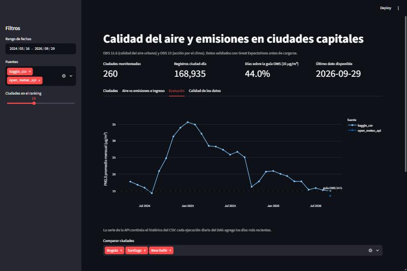
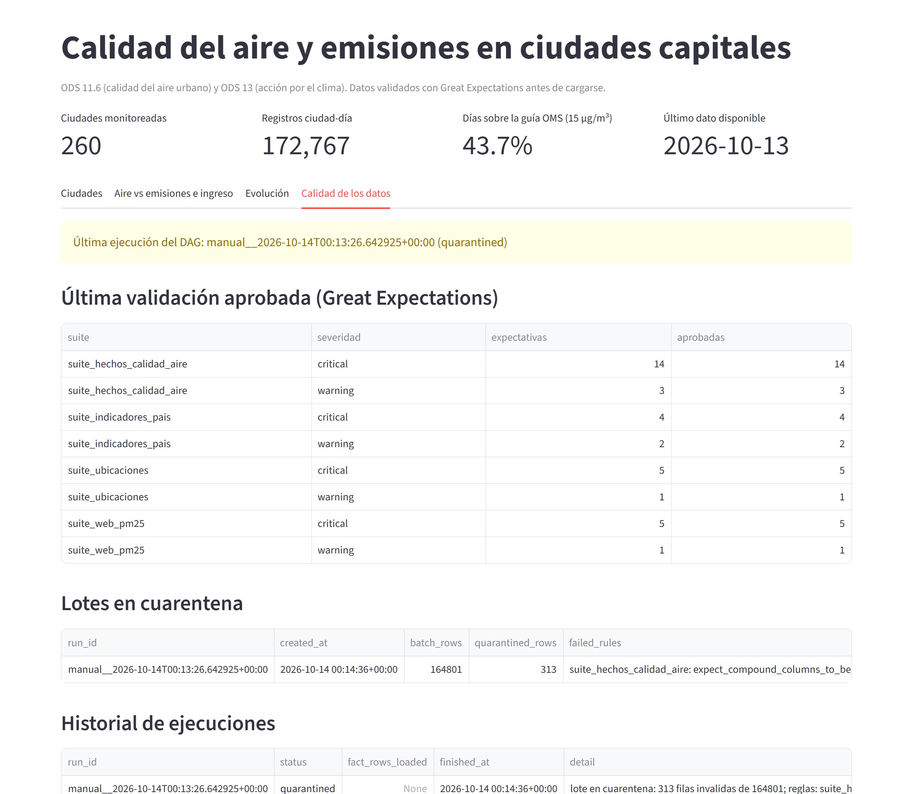

# ETL de clima, calidad del aire y emisiones con Airflow

Pipeline ETL orquestado con Apache Airflow que integra cuatro fuentes (un CSV histórico, una base de datos, una API pública y una tabla web extraída con scraping), valida su calidad con Great Expectations, carga un Data Warehouse en PostgreSQL con modelo estrella solo los lotes que la superan y envía a cuarentena los que no. Un dashboard en Streamlit consulta únicamente los datos ya validados. El proyecto está alineado con el ODS 11 (calidad del aire urbano) y el ODS 13 (acción por el clima).

Curso ETL (G51), Ingeniería de Datos e Inteligencia Artificial, Universidad Autónoma de Occidente. Autoras: Yurani Duque y Valentina Velasco.

Este proyecto parte del dataset del proyecto anterior del curso ([etl-clima-calidad-aire](https://github.com/yurani-duque/etl-clima-calidad-aire)), que cargaba un CSV a un esquema estrella. Aquí se automatiza con Airflow, se suman tres fuentes nuevas (base de datos, API y web), se valida la calidad antes de cargar y se agrega un dashboard.

## Contenido

1. [Objetivos refinados](#1-objetivos-refinados)
2. [Arquitectura](#2-arquitectura)
3. [Fuentes de datos](#3-fuentes-de-datos)
4. [EDA y hallazgos](#4-eda-y-hallazgos)
5. [Pasos del pipeline ETL](#5-pasos-del-pipeline-etl)
6. [Diseño del DAG de Airflow](#6-diseño-del-dag-de-airflow)
7. [Validación con Great Expectations](#7-validación-con-great-expectations)
8. [Modelo de datos](#8-modelo-de-datos)
9. [Visualizaciones e insights](#9-visualizaciones-e-insights)
10. [Puesta en marcha](#10-puesta-en-marcha)
11. [Pruebas](#11-pruebas)
12. [Estructura del repositorio](#12-estructura-del-repositorio)
13. [Decisiones clave](#13-decisiones-clave)
14. [Solución de problemas](#14-solución-de-problemas)
15. [Licencias y atribución de datos](#15-licencias-y-atribución-de-datos)

## 1. Objetivos refinados

El proyecto anterior solo respondía qué ciudades tienen peor aire a partir de un CSV. Con las nuevas fuentes el objetivo es más amplio:

1. Monitorear de forma continua la calidad del aire de 260 ciudades capitales frente a la guía de la OMS para PM2.5 (15 µg/m³ en 24 horas), extendiendo el histórico del CSV con datos diarios de una API.
2. Relacionar el aire de cada ciudad con las emisiones de CO₂, el PIB y la energía per cápita de su país, para ver si el nivel de emisiones o de ingreso se asocia con la contaminación.
3. Contrastar la medición de cada ciudad con el promedio anual de PM2.5 de su país y con los años de vida perdidos por la contaminación, publicados en una tabla web.
4. Garantizar que solo se cargan datos válidos: cada ejecución se valida y, si falla una regla crítica, el lote va a cuarentena, se emite una alerta y la carga no se ejecuta.

Preguntas que guían el modelo: ¿qué ciudades superan la guía de la OMS y con qué frecuencia?, ¿se relaciona la contaminación con las emisiones y el ingreso del país?, ¿cómo evoluciona el PM2.5 y qué tan frescos están los datos?, ¿en qué estado está la calidad del dato?

## 2. Arquitectura



Todo corre con Docker Compose: Airflow (API server, scheduler y DAG processor), un PostgreSQL para los metadatos de Airflow, un PostgreSQL que actúa como Data Warehouse y como base de datos fuente, y el dashboard.

| Capa | Herramienta | Propósito |
|---|---|---|
| Orquestación | Apache Airflow 3.3 | programar y ejecutar el DAG diario |
| Fuentes | CSV, PostgreSQL, API Open-Meteo, página web | datos históricos, indicadores por país, datos frescos y referencia nacional de PM2.5 |
| Transformación | Python y pandas | limpieza, normalización y unión |
| Calidad | Great Expectations 1.23 | validar antes de cargar |
| Almacenamiento | PostgreSQL 16 (o Supabase) | Data Warehouse en esquema `dw` |
| Visualización | Streamlit y Plotly | dashboard sobre el Data Warehouse |
| Versionamiento | Git y GitHub | código, configuración y documentación |

## 3. Fuentes de datos

| # | Fuente | Acceso | Contenido |
|---|---|---|---|
| 1 | World Weather Repository (Kaggle), dataset del proyecto anterior | archivo `data/raw/GlobalWeatherRepository.csv.gz` | 164,109 lecturas de clima y calidad del aire de 286 capitales, del 2024-05-16 al 2026-09-08 |
| 2 | Our World in Data, emisiones de CO₂ y economía | tabla `source.owid_co2` en PostgreSQL (SQL) | 50,411 filas país-año con 79 columnas (población, PIB, CO₂, energía) |
| 3 | Open-Meteo (calidad del aire y clima) | API REST pública, sin llave | PM2.5, PM10, CO, NO₂, SO₂, O₃, AQI de EE.UU., temperatura, humedad, viento, presión, lluvia, nubosidad y UV |
| 4 | Wikipedia, [List of countries by air pollution](https://en.wikipedia.org/wiki/List_of_countries_by_air_pollution) | web scraping con `requests` y `BeautifulSoup` | 217 países con PM2.5 anual (µg/m³) y años de esperanza de vida perdidos por la contaminación |

**Por qué Open-Meteo.** Es gratuita y no exige registro ni API key, lo que permite que cualquiera reproduzca el proyecto sin configurar credenciales. Devuelve datos estructurados en JSON con las mismas variables y unidades (µg/m³) que el CSV, acepta varias ubicaciones por petición y su histórico reciente permite continuar la serie del CSV, que termina el 2026-09-08. Cada ejecución diaria agrega los días nuevos. Límites: uso no comercial y cuotas por hora, que el pipeline respeta consultando por bloques de 25 ciudades, con espera exponencial ante errores 429 o 5xx, y pidiendo solo los días que faltan.

**Por qué el dataset de emisiones.** Our World in Data es una fuente abierta y citable, con código ISO por país, lo que permite unirla con el CSV de forma limpia y responder la relación entre aire, emisiones e ingreso (ODS 13).

**Por qué la tabla web.** Aporta un dato que ninguna otra fuente tiene: el PM2.5 anual de cada país y su efecto en la esperanza de vida. Permite contrastar la medición de una ciudad con la referencia nacional. Se eligió una página estable, con estructura de tabla y licencia abierta (CC BY-SA). Como la cifra es anual, no cambia entre ejecuciones diarias; se vuelve a descargar en cada corrida para que el DAG siga siendo autocontenido. La extracción se identifica con un `User-Agent`, tiene tiempo máximo de espera y falla de forma explícita si la tabla cambia de estructura.

## 4. EDA y hallazgos

El análisis está en [`notebooks/eda_fuentes.ipynb`](notebooks/eda_fuentes.ipynb) (estructura, tipos, nulos, duplicados y atípicos de las cuatro fuentes). Los hallazgos determinan las transformaciones:

| Hallazgo | Decisión |
|---|---|
| 383 pares ciudad-día tienen dos lecturas | conservar la más reciente |
| 33 nombres de país en otros idiomas o variantes (`Südkorea`, `Польша`, `火鸡`) | tabla `config/paises_iso3.csv` que normaliza a ISO3 |
| Las coordenadas de una ciudad cambian con el tiempo y hay ciudades con dos nombres | ubicación canónica por país y ciudad con las coordenadas más recientes (286 nombres pasan a 260 ubicaciones) |
| Valores negativos en contaminantes | descartar esas filas |
| Una lectura de 79.3 °C en Suva (Fiyi) | descartar temperaturas fuera de -90 a 60 °C |
| PM10 llega a 6,000 µg/m³ en Riad (tormentas de polvo reales) | no se tratan como error; el límite de validación es 10,000 |
| El PIB no tiene datos recientes y hay 7,931 filas agregadas sin ISO | último dato disponible por indicador y país; se excluyen agregados |
| La API entrega horas y el CSV una lectura por día | promedio diario, mínimo 18 horas, sin el día en curso |
| API y CSV se solapan | la API solo aporta días posteriores al último del CSV |
| El índice EPA del CSV es categórico y la API entrega el AQI numérico | derivar la categoría EPA (1 a 6) del AQI |
| La tabla web usa el signo menos tipográfico (`−4.82`, 174 valores) y 39 de sus 217 nombres no están en el mapa de países | convertir a numérico (magnitud positiva) y asignar ISO3 por nombre de origen, nombre estándar o alias; 1 territorio sin ISO3 se descarta; la limpieza también quita notas al pie si la página las agrega |



## 5. Pasos del pipeline ETL

| Paso | Módulo | Qué hace |
|---|---|---|
| Preparación de la fuente | `src/seed_source_db.py` | carga el dataset de emisiones en `source.owid_co2` (idempotente) |
| Extract CSV | `src/extract_csv.py` | lee el CSV, valida columnas y lo deja en staging (parquet) |
| Extract DB | `src/extract_db.py` | consulta con SQL la tabla `source.owid_co2` por bloques |
| Extract API | `src/extract_api.py` | consulta Open-Meteo por bloques de ciudades, solo los días faltantes |
| Extract Web | `src/extract_web.py` | descarga la página con `requests`, localiza la tabla con `BeautifulSoup` y la deja en staging |
| Transform CSV | `src/transform_csv.py` | renombra a snake_case, fechas, ISO3, ubicaciones canónicas, duplicados y valores inválidos |
| Transform OWID | `src/transform_owid.py` | un valor vigente por país e indicador, sin agregados |
| Transform API | `src/transform_api.py` | horas a promedio diario, EPA desde AQI, solo días completos |
| Transform Web | `src/transform_web.py` | quita notas al pie, convierte a numérico y asigna ISO3 a cada país |
| Merge | `src/merge.py` | dataset enriquecido: lecturas de CSV y API más indicadores del país, PM2.5 nacional de la web y la diferencia de cada lectura con ese promedio |
| Validación | `src/quality.py` | cuatro suites de Great Expectations y registro de resultados; decide la ruta del lote |
| Cuarentena | `src/quarantine.py` | si la validación falla: guarda las filas inválidas con su motivo, registra el lote en `dw.quarantine_log` y emite una alerta |
| Load | `src/load_dw.py` | dimensiones y luego hechos, en una transacción con carga masiva (`COPY`) |

**Estrategia de carga.** Las dimensiones se actualizan con upsert. Los hechos del CSV usan `ON CONFLICT DO NOTHING` (son históricos) y los de la API `DO UPDATE` (se refrescan los últimos días). La clave de un hecho es `(location_id, date_id, source_id)`, por lo que reejecutar el pipeline no duplica datos.

**Supuestos y decisiones de transformación**

- El CSV trae una lectura puntual por ciudad y día; la API, promedios diarios. Se documenta la diferencia con la columna `source`.
- En las lecturas de la API, `wind_kph` es el máximo diario y las demás variables son promedios; en el CSV son valores puntuales.
- Los indicadores del país (CO₂, PIB, población, energía) son una foto del último año disponible de cada serie, no una serie temporal, porque no terminan el mismo año. El año de cada valor se conserva (`*_year`).
- Un país sin indicadores (Kosovo, sin ISO en OWID) queda con esos campos nulos.
- El día en curso se excluye porque está incompleto.
- El PM2.5 nacional de la web es un promedio anual por país, no una lectura diaria. La medida `pm25_vs_national` (lectura diaria menos promedio anual del país) sirve para comparar, no para sustituir la medición de la ciudad. Los años de vida perdidos se guardan como magnitud positiva.
- Un país con ciudades pero sin fila en la web queda con esos campos nulos; la columna `pm25_vs_national` también.

## 6. Diseño del DAG de Airflow

DAG `etl_calidad_aire`, programado `@daily`, con `catchup=False` y una sola ejecución activa a la vez.



- **Cuatro extracciones independientes** (`extract_csv`, `extract_db`, `extract_api`, `extract_web`) que corren en paralelo, cada una con su transformación (12 tareas en total).
- `merge_sources` espera las cuatro transformaciones.
- `validate_quality` ejecuta Great Expectations y **decide la ruta** (es una tarea de ramificación): si la calidad es buena sigue a `load_dw`; si falla una regla crítica el flujo continúa por `quarantine_data` y `load_dw` queda omitido (`skipped`). En la imagen, un run con datos inválidos inyectados: el lote termina en cuarentena.
- `quarantine_data` identifica las filas inválidas del lote con su motivo, las guarda en `data/quarantine/<run_id>/`, registra el lote en `dw.quarantine_log`, deja la ejecución con estado `quarantined` en `dw.etl_run_log` y emite una alerta en el log de la tarea. El Data Warehouse no cambia.
- `load_dw` carga el Data Warehouse y registra la ejecución.
- Reintentos: 2 por tarea con 2 minutos de espera. Un fallo que no es temporal, como un archivo CSV dañado, agota los reintentos, falla la tarea y requiere intervención. Un `on_failure_callback` registra cualquier fallo en `dw.etl_run_log`.
- Los datos pasan entre tareas como archivos parquet en `data/staging/<run_id>/`, no por XCom.
- Parámetro `prueba_falla_calidad` (falso por defecto): al activarlo, `merge_sources` agrega filas inválidas para demostrar la cuarentena del lote.

Una ejecución exitosa:



## 7. Validación con Great Expectations

Las suites se definen en `src/quality.py` y se versionan como JSON en `gx/expectations/`. Cada expectativa es **crítica** (envía el lote a cuarentena y bloquea la carga) o **advertencia** (solo se registra). El resultado de cada expectativa se guarda en `dw.dq_validation_log` y se generan Data Docs en `gx/uncommitted/data_docs/`.

| Suite | Datos | Críticas | Advertencias | Reglas principales |
|---|---|---|---|---|
| `suite_hechos_calidad_aire` | dataset enriquecido | 14 | 3 | filas entre 100 mil y 5 millones; claves no nulas; fuente válida; unicidad de `(ubicación, fecha, fuente)`; humedad y nubosidad 0-100; temperatura -90 a 60; viento, presión, PM2.5, PM10 e índice EPA en rangos físicos; frescura del último día; nulos de PM2.5 y temperatura |
| `suite_ubicaciones` | ubicaciones únicas | 5 | 1 | clave única; nombre no nulo; latitud y longitud válidas; ISO3 con formato `AAA`; ISO3 con indicadores |
| `suite_indicadores_pais` | indicadores por país | 4 | 2 | entre 150 y 260 países; ISO3 único y no nulo; población positiva; rango de CO₂ per cápita; cobertura de PIB |
| `suite_web_pm25` | tabla extraída de la web | 5 | 1 | entre 150 y 260 países; ISO3 no nulo, único y con formato `AAA`; PM2.5 anual entre 0 y 100; años de vida perdidos entre 0 y 10 (advertencia) |



La imagen muestra la validación de un run con datos inválidos: 15 de 17 expectativas cumplidas y dos críticas fallidas (humedad fuera de rango y filas repetidas), suficiente para enviar el lote a cuarentena.

## 8. Modelo de datos

Esquema estrella en el esquema `dw` (DDL en [`dwh_version/001_create_dw_schema.sql`](dwh_version/001_create_dw_schema.sql)):



- **Hechos** `fact_air_quality`: una fila por ciudad, día y fuente, con clima, contaminantes, índice EPA, razón contra la guía OMS y bandera `pm25_exceeds_who`, más `pm25_vs_national` (lectura menos el PM2.5 anual del país).
- **Dimensiones**: `dim_location`, `dim_date`, `dim_source` y `dim_country_indicator` (una fila por país, con los indicadores de OWID y el PM2.5 anual y los años de vida perdidos de la web).
- **Auditoría**: `dq_validation_log` (resultados de validación), `quarantine_log` (lotes enviados a cuarentena) y `etl_run_log` (estado de cada ejecución: `success`, `quarantined` o `failed`).

## 9. Visualizaciones e insights

El dashboard ([`dashboard/app.py`](dashboard/app.py)) solo consulta el esquema `dw`, es decir, datos ya validados.



Con los datos cargados al 2026-10-10 (171,788 registros ciudad-día):

- 43.8% de los registros superan la guía diaria de la OMS para PM2.5, y 88 de 260 ciudades la superan en más de la mitad de los días. Riad, Santiago, Yakarta, Pekín y Nueva Delhi encabezan el ranking.
- La correlación de Spearman entre PM2.5 y CO₂ per cápita del país es -0.08 (187 países) y con el PIB per cápita es -0.22 (159 países): la contaminación urbana de las capitales casi no se explica por las emisiones per cápita del país y solo se asocia débilmente con un menor ingreso.
- Con la fuente web, 165 de 259 ciudades tienen un PM2.5 promedio mayor que el promedio anual de su país: las capitales concentran más contaminación que el promedio nacional. La gráfica "Ciudad frente al promedio nacional" colorea cada ciudad por los años de vida perdidos de su país.
- La serie mensual muestra un máximo a inicios de 2025 y la continuación con datos de la API.





La pestaña **Calidad de los datos** muestra el estado de la última ejecución, el resumen de la última validación aprobada y el historial, incluida la ejecución enviada a cuarentena en la demostración y la tabla de lotes en cuarentena:



## 10. Puesta en marcha

### Requisitos

- Docker Desktop con Docker Compose v2 y al menos 8 GB de RAM disponibles para Docker.
- Puertos libres: 8080 (Airflow), 8501 (dashboard) y 5433 (Data Warehouse).
- Conexión a internet (imágenes de Docker y API).

### Pasos

```bash
git clone https://github.com/yurani-duque/etl-airflow-calidad-aire.git
cd etl-airflow-calidad-aire
cp .env.example .env
docker compose up -d --build
```

En Windows con PowerShell, el tercer comando es `copy .env.example .env`. La primera vez tarda varios minutos porque construye las imágenes. Los valores por defecto del `.env` apuntan al PostgreSQL local del compose, así que no hay que configurar nada.

Al arrancar, un servicio de preparación carga el dataset de emisiones en la base fuente y el scheduler queda activo.

1. Abrir Airflow en http://localhost:8080 (sin usuario ni contraseña).
2. Abrir el DAG `etl_calidad_aire` y pulsar **Trigger**. Tarda entre 2 y 5 minutos. El scheduler también puede lanzar una primera ejecución automática al arrancar; ambas son equivalentes porque la carga es idempotente.
3. Cuando el run termine en `success`, abrir el dashboard en http://localhost:8501.

Verificar la carga desde la terminal:

```bash
docker compose exec warehouse psql -U dwh -d dwh -c "select count(*) from dw.fact_air_quality"
```

### Demostrar la cuarentena por calidad

En Airflow, **Trigger DAG w/ config** y activar `prueba_falla_calidad` (o ejecutar el comando de abajo). La tarea `validate_quality` detecta las reglas críticas fallidas y envía el lote a `quarantine_data`; `load_dw` queda omitido y el Data Warehouse no cambia. Para revisar el resultado: la pestaña **Calidad de los datos** del dashboard muestra el lote en cuarentena, y la carpeta `data/quarantine/<run_id>/` contiene `filas_cuarentena.parquet` (cada fila con su motivo) y `reporte.json`.

```bash
docker compose exec airflow-scheduler airflow dags trigger etl_calidad_aire --conf '{"prueba_falla_calidad": true}'
```

### Usar Supabase u otro PostgreSQL

Reemplazar en `.env` los valores `DB_HOST`, `DB_PORT`, `DB_NAME`, `DB_USER` y `DB_PASSWORD` por las credenciales del servidor y volver a levantar el compose. El pipeline crea los esquemas `source` y `dw` automáticamente. El `.env` está en `.gitignore` y nunca se sube.

### Conectar Power BI (opcional)

Obtener datos, PostgreSQL, servidor `localhost:5433`, base `dwh`, usuario `dwh` y contraseña `dwh_password`. Importar las tablas del esquema `dw`.

### Apagar

```bash
docker compose down        # conserva los datos
docker compose down -v     # borra también los volúmenes
```

## 11. Pruebas

Pruebas de transformaciones (incluida la extracción y limpieza de la tabla web con HTML de ejemplo), ubicaciones y extracción incremental (Python 3.14 con `uv`):

```bash
uv sync
uv run pytest
```

Pruebas de las suites de Great Expectations (incluye datos corruptos que deben bloquear la carga y la identificación de filas para cuarentena) y del DAG, dentro del contenedor:

```bash
docker compose run --rm tests
```

## 12. Estructura del repositorio

```
config/          configuración (config.yaml) y tabla de países a ISO3
dags/            DAG de Airflow
src/             extracción, transformación, unión, validación y carga
utils/           conexión, configuración y logging
dwh_version/     DDL del Data Warehouse
gx/              configuración y expectativas de Great Expectations
dashboard/       aplicación de Streamlit
notebooks/       EDA de las cuatro fuentes
test/            pruebas unitarias
docs/            documento técnico, diagramas y capturas
data/raw/        copias comprimidas de los datos de origen
data/quarantine/ filas inválidas de los lotes enviados a cuarentena (se genera al ejecutar)
docker/          Dockerfiles de Airflow y del dashboard
docker-compose.yml, requirements-*.txt, .env.example
```

## 13. Decisiones clave

- **Airflow en Docker Compose con LocalExecutor**: un solo comando levanta el proyecto y es reproducible en cualquier equipo; no se necesita Celery ni Redis para este volumen.
- **PostgreSQL parametrizado por variables de entorno**: por defecto un contenedor local, y Supabase u otro servidor cambiando solo el `.env`.
- **Great Expectations dentro del DAG y con severidades**: reglas críticas envían el lote a cuarentena y bloquean la carga; las advertencias solo informan.
- **Cuarentena del lote completo**: si falla una regla crítica no se carga nada de ese lote, porque mezclar filas buenas y malas podría dejar el almacén inconsistente; las filas inválidas quedan identificadas con su motivo para corregirlas y reprocesar.
- **Extracción incremental de la API**: se piden solo los días posteriores al último cargado, lo que reduce las peticiones y respeta los límites.
- **Ubicación canónica y tabla de países**: resuelve nombres en otros idiomas y coordenadas cambiantes en el origen.
- **Scraping acotado a una tabla estable**: se extrae una sola tabla de una página con licencia abierta, con `User-Agent` propio y tiempo máximo de espera; si la estructura cambia, la tarea falla en lugar de cargar datos incorrectos.
- **Datos comprimidos en el repositorio** (17 MB): para que el proyecto corra sin descargas manuales ni cuentas de terceros.
- **Python 3.12 en los contenedores**: Great Expectations 1.x aún no soporta Python 3.14, que se usa en el entorno local con `uv`.

## 14. Solución de problemas

| Síntoma | Causa y solución |
|---|---|
| `port is already allocated` | otro programa usa 8080, 8501 o 5433; cerrarlo o cambiar el puerto en `docker-compose.yml` |
| El DAG no aparece | esperar unos 30 segundos y refrescar; ver `docker compose logs airflow-dag-processor` |
| `extract_api` falla con 429 | límite de la API gratuita; reintentar en unos minutos |
| `extract_web` falla | la página no responde o cambió la estructura de la tabla; Airflow reintenta dos veces. Si persiste, revisar la URL en `config/config.yaml` y el mensaje del log |
| El dashboard muestra errores de conexión | esperar a que `warehouse` esté saludable (`docker compose ps`) y correr el DAG al menos una vez |
| `no matching manifest` al construir | Docker Desktop debe usar contenedores de Linux |

## 15. Licencias y atribución de datos

- Datos meteorológicos y de calidad del aire: [Open-Meteo](https://open-meteo.com/) (CC BY 4.0), uso no comercial.
- Emisiones y economía: [Our World in Data, CO₂ and Greenhouse Gas Emissions](https://github.com/owid/co2-data) (CC BY 4.0).
- PM2.5 anual por país y años de vida perdidos: [Wikipedia, List of countries by air pollution](https://en.wikipedia.org/wiki/List_of_countries_by_air_pollution) (CC BY-SA 4.0), que a su vez cita datos del Banco Mundial y de la OMS.
- Lecturas históricas: [World Weather Repository, Kaggle](https://www.kaggle.com/datasets/nelgiriyewithana/global-weather-repository), publicado por Nidula Elgiriyewithana.
- Guía de calidad del aire de la OMS (2021) para el umbral de PM2.5 de 15 µg/m³ en 24 horas.
