# ETL de clima, calidad del aire y emisiones: Airflow, Kafka y predicción en tiempo real

Proyecto de ingeniería de datos que integra cuatro fuentes (un CSV histórico, una base de datos, una API pública y una tabla web extraída con scraping) en un pipeline orquestado con Apache Airflow, valida su calidad con Great Expectations y carga un Data Warehouse en PostgreSQL con modelo estrella solo con los lotes que pasan la validación (los demás van a cuarentena). Sobre ese mismo almacén se apoyan **dos formas de consumir los datos**:

- **Analítica:** un informe estático generado con Python y un dashboard, ambos sobre el modelo dimensional validado.
- **Operativa:** un modelo de aprendizaje automático que predice el PM2.5 del día siguiente en cada ciudad, un productor de Kafka que publica las variables de entrada y un consumidor que predice cada mensaje y alimenta un dashboard en tiempo real.

El proyecto está alineado con el ODS 11 (calidad del aire urbano) y el ODS 13 (acción por el clima).

Curso ETL (G51), Ingeniería de Datos e Inteligencia Artificial, Universidad Autónoma de Occidente. Autoras: Yurani Duque y Valentina Velasco.

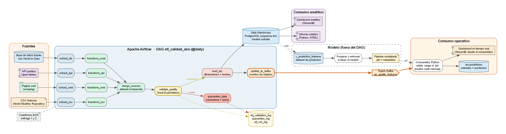

## Contenido

1. [Objetivos refinados](#1-objetivos-refinados)
2. [Evolución del proyecto](#2-evolución-del-proyecto)
3. [Arquitectura](#3-arquitectura)
4. [Fuentes de datos](#4-fuentes-de-datos)
5. [EDA y hallazgos](#5-eda-y-hallazgos)
6. [Pasos del pipeline ETL](#6-pasos-del-pipeline-etl)
7. [Diseño del DAG de Airflow](#7-diseño-del-dag-de-airflow)
8. [Validación con Great Expectations](#8-validación-con-great-expectations)
9. [Modelo dimensional y métrica publicada](#9-modelo-dimensional-y-métrica-publicada)
10. [Eventos de Kafka: productor y consumidor](#10-eventos-de-kafka-productor-y-consumidor)
11. [Modelo de aprendizaje automático](#11-modelo-de-aprendizaje-automático)
12. [Informe estático](#12-informe-estático)
13. [Dashboard en tiempo real](#13-dashboard-en-tiempo-real)
14. [Valor analítico y operativo](#14-valor-analítico-y-operativo)
15. [Visualizaciones e insights](#15-visualizaciones-e-insights)
16. [Puesta en marcha](#16-puesta-en-marcha)
17. [Pruebas](#17-pruebas)
18. [Estructura del repositorio](#18-estructura-del-repositorio)
19. [Decisiones clave](#19-decisiones-clave)
20. [Limitaciones](#20-limitaciones)
21. [Solución de problemas](#21-solución-de-problemas)
22. [Licencias y atribución de datos](#22-licencias-y-atribución-de-datos)

## 1. Objetivos refinados

La primera entrega solo respondía qué ciudades tienen peor aire a partir de un CSV. Con las nuevas fuentes y el streaming el objetivo es más amplio:

1. Monitorear de forma continua la calidad del aire de 260 ciudades capitales frente a la guía de la OMS para PM2.5 (15 µg/m³ en 24 horas), extendiendo el histórico del CSV con datos diarios de una API.
2. Relacionar el aire de cada ciudad con las emisiones de CO₂, el PIB y la energía per cápita de su país, para ver si el nivel de emisiones o de ingreso se asocia con la contaminación.
3. Contrastar la medición de cada ciudad con el promedio anual de PM2.5 de su país y con los años de vida perdidos por la contaminación, publicados en una tabla web.
4. Garantizar que solo se cargan datos válidos: cada ejecución se valida y, si falla una regla crítica, el lote va a cuarentena, se emite una alerta y la carga no se ejecuta.
5. Predecir el PM2.5 del día siguiente en cada ciudad para emitir una alerta temprana cuando se prevea superar un margen bajo la guía de la OMS, y mostrarlo en tiempo real.

Preguntas que guían el modelo: ¿qué ciudades superan la guía de la OMS y con qué frecuencia?, ¿se relaciona la contaminación con las emisiones y el ingreso del país?, ¿cómo evoluciona el PM2.5 y qué tan frescos están los datos?, ¿en qué estado está la calidad del dato?

## 2. Evolución del proyecto
El proyecto creció en tres entregas, y cada una corrigió supuestos de la anterior:

| Entrega | Qué se construyó | Supuesto que hubo que corregir |
|---|---|---|
| **1. ETL y modelo estrella** ([repositorio](https://github.com/yurani-duque/etl-clima-calidad-aire)) | Un CSV de clima y calidad del aire (World Weather Repository) limpiado y cargado a un esquema estrella en PostgreSQL | "Una ciudad es un nombre": había 286 nombres para 260 ciudades reales, con coordenadas que cambiaban y países en otros idiomas |
| **2. Airflow, calidad y API** | DAG con tres extracciones en paralelo (CSV, base de datos de emisiones, API Open-Meteo), validación con Great Expectations antes de cargar, cuarentena de lotes inválidos y dashboard | "La API se parece al CSV": entrega horas y el CSV una lectura por día; la API tiene cuotas, así que la extracción pasó a ser incremental. Se sumó una cuarta fuente (tabla web) por scraping |
| **3. Streaming y ML (final)** | Vista de predicción sobre el modelo dimensional, modelo del PM2.5 del día siguiente, productor y consumidor de Kafka, dashboard en tiempo real e informe estático | "Si el modelo se entrena, el problema está resuelto": la línea base "mañana = hoy" ya es muy fuerte, así que se compara siempre contra ella y se reporta una mejora moderada |

Otros quiebres técnicos que se resolvieron en el camino:

- **Great Expectations no soporta Python 3.14**: los contenedores usan Python 3.12 y el entorno local, `uv` con 3.14.
- **Una lectura de 79.3 °C en Fiyi** (error del origen) y **picos de PM10 de 6,000 µg/m³** (tormentas de polvo reales): lo primero se descarta, lo segundo se conserva y se ajusta el límite de validación a 10,000.
- **La calidad mala no podía solo detener el flujo**: por indicación del docente, la validación ahora enruta el lote a cuarentena con una alerta.
- **No todas las ciudades tienen el mismo "último día"**: el productor publica el último día disponible de cada ciudad, no el último día global (con la segunda opción solo se publicaban 23 de 260 ciudades).
- **El esquema de eventos cambió** al agregar variables al modelo: el consumidor descartó correctamente los eventos antiguos por validación en lugar de predecir con datos incompletos.

## 3. Arquitectura


Todo corre con Docker Compose: Airflow (API server, scheduler y DAG processor), un PostgreSQL para los metadatos de Airflow, un PostgreSQL que actúa como Data Warehouse y como base de datos fuente, Kafka (modo KRaft, un solo nodo), el dashboard analítico y la aplicación en tiempo real (consumidor + dashboard).

| Capa | Herramienta | Propósito |
|---|---|---|
| Orquestación | Apache Airflow 3.3 | programar y ejecutar el DAG diario |
| Fuentes | CSV, PostgreSQL, API Open-Meteo, página web | datos históricos, indicadores por país, datos frescos y referencia nacional de PM2.5 |
| Transformación | Python y pandas | limpieza, normalización y unión |
| Calidad | Great Expectations 1.23 | validar antes de cargar |
| Almacenamiento | PostgreSQL 16 (o Supabase) | Data Warehouse en esquema `dw` |
| Streaming | Apache Kafka 3.9 y `confluent-kafka` | transportar los eventos con las variables de entrada del modelo |
| Aprendizaje automático | scikit-learn | modelo de predicción del PM2.5 del día siguiente |
| Reporte estático | Python, matplotlib | informe HTML sobre el modelo dimensional |
| Visualización | Streamlit y Plotly | dashboard analítico (puerto 8501) y dashboard en tiempo real (puerto 8502) |
| Versionamiento | Git y GitHub | código, configuración y documentación |

## 4. Fuentes de datos

| # | Fuente | Acceso | Contenido |
|---|---|---|---|
| 1 | World Weather Repository (Kaggle), dataset del proyecto anterior | archivo `data/raw/GlobalWeatherRepository.csv.gz` | 164,109 lecturas de clima y calidad del aire de 286 capitales, del 2024-05-16 al 2026-09-08 |
| 2 | Our World in Data, emisiones de CO₂ y economía | tabla `source.owid_co2` en PostgreSQL (SQL) | 50,411 filas país-año con 79 columnas (población, PIB, CO₂, energía) |
| 3 | Open-Meteo (calidad del aire y clima) | API REST pública, sin llave | PM2.5, PM10, CO, NO₂, SO₂, O₃, AQI de EE.UU., temperatura, humedad, viento, presión, lluvia, nubosidad y UV |
| 4 | Wikipedia, [List of countries by air pollution](https://en.wikipedia.org/wiki/List_of_countries_by_air_pollution) | web scraping con `requests` y `BeautifulSoup` | 217 países con PM2.5 anual (µg/m³) y años de esperanza de vida perdidos por la contaminación |

**Por qué Open-Meteo.** Es gratuita y no exige registro ni API key, lo que permite que cualquiera reproduzca el proyecto sin configurar credenciales. Devuelve datos estructurados en JSON con las mismas variables y unidades (µg/m³) que el CSV, acepta varias ubicaciones por petición y su histórico reciente permite continuar la serie del CSV, que termina el 2026-09-08. Cada ejecución diaria agrega los días nuevos. Límites: uso no comercial y cuotas por hora, que el pipeline respeta consultando por bloques de 25 ciudades, con espera exponencial ante errores 429 o 5xx, y pidiendo solo los días que faltan.

**Por qué el dataset de emisiones.** Our World in Data es una fuente abierta y citable, con código ISO por país, lo que permite unirla con el CSV de forma limpia y responder la relación entre aire, emisiones e ingreso (ODS 13).

**Por qué la tabla web.** Aporta un dato que ninguna otra fuente tiene: el PM2.5 anual de cada país y su efecto en la esperanza de vida. Permite contrastar la medición de una ciudad con la referencia nacional. Se eligió una página estable, con estructura de tabla y licencia abierta (CC BY-SA). Como la cifra es anual, no cambia entre ejecuciones diarias; se vuelve a descargar en cada corrida para que el DAG siga siendo autocontenido. La extracción se identifica con un `User-Agent`, tiene tiempo máximo de espera y falla de forma explícita si la tabla cambia de estructura.

## 5. EDA y hallazgos

Los análisis están en [`notebooks/eda_entrega1_clima_calidad_aire.ipynb`](notebooks/eda_entrega1_clima_calidad_aire.ipynb) (EDA de la primera entrega) y [`notebooks/eda_fuentes.ipynb`](notebooks/eda_fuentes.ipynb) (estructura, tipos, nulos, duplicados y atípicos de las cuatro fuentes, segunda entrega). Los hallazgos determinan las transformaciones:

| Hallazgo | Decisión |
|---|---|
| 383 pares ciudad-día tienen dos lecturas | conservar la más reciente |
| 33 nombres de país en otros idiomas o variantes (`Südkorea`, `Польша`, `火鸡`) | tabla `config/paises_iso3.csv` que normaliza a ISO3 |
| Las coordenadas de una ciudad cambian con el tiempo y hay ciudades con dos nombres | ubicación canónica por país y ciudad con las coordenadas más recientes (286 nombres pasan a 260 ubicaciones) |
| Valores negativos en contaminantes | descartar esas filas |
| Una lectura de 79.3 °C en Suva (Fiyi) | descartar temperaturas fuera de -90 a 60 °C |
| PM10 llega a 6,000 µg/m³ en Riad (tormentas de polvo reales) | no se tratan como error; el límite de validación es 10,000 |
| El PIB no tiene datos recientes y hay 7,931 filas agregadas sin ISO | último dato disponible por indicador y país; se excluyen agregados |
| La API entrega horas y el CSV una lectura por día | promedio diario, mínimo 18 horas, sin el día en curso |
| API y CSV se solapan | la API solo aporta días posteriores al último del CSV |
| El índice EPA del CSV es categórico y la API entrega el AQI numérico | derivar la categoría EPA (1 a 6) del AQI |
| La tabla web usa el signo menos tipográfico (`−4.82`, 174 valores) y 39 de sus 217 nombres no están en el mapa de países | convertir a numérico (magnitud positiva) y asignar ISO3 por nombre de origen, nombre estándar o alias; 1 territorio sin ISO3 se descarta; la limpieza también quita notas al pie si la página las agrega |

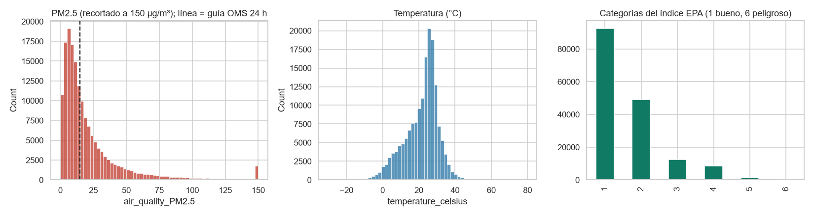

## 6. Pasos del pipeline ETL

| Paso | Módulo | Qué hace |
|---|---|---|
| Preparación de la fuente | `src/seed_source_db.py` | carga el dataset de emisiones en `source.owid_co2` (idempotente) |
| Extract CSV | `src/extract_csv.py` | lee el CSV, valida columnas y lo deja en staging (parquet) |
| Extract DB | `src/extract_db.py` | consulta con SQL la tabla `source.owid_co2` por bloques |
| Extract API | `src/extract_api.py` | consulta Open-Meteo por bloques de ciudades, solo los días faltantes |
| Extract Web | `src/extract_web.py` | descarga la página con `requests`, localiza la tabla con `BeautifulSoup` y la deja en staging |
| Transform CSV | `src/transform_csv.py` | renombra a snake_case, fechas, ISO3, ubicaciones canónicas, duplicados y valores inválidos |
| Transform OWID | `src/transform_owid.py` | un valor vigente por país e indicador, sin agregados |
| Transform API | `src/transform_api.py` | horas a promedio diario, EPA desde AQI, solo días completos |
| Transform Web | `src/transform_web.py` | quita notas al pie, convierte a numérico y asigna ISO3 a cada país |
| Merge | `src/merge.py` | dataset enriquecido: lecturas de CSV y API más indicadores del país, PM2.5 nacional de la web y la diferencia de cada lectura con ese promedio |
| Validación | `src/quality.py` | cuatro suites de Great Expectations y registro de resultados; decide la ruta del lote |
| Cuarentena | `src/quarantine.py` | si la validación falla: guarda las filas inválidas con su motivo, registra el lote en `dw.quarantine_log` y emite una alerta |
| Load | `src/load_dw.py` | dimensiones y luego hechos, en una transacción con carga masiva (`COPY`) |

**Estrategia de carga.** Las dimensiones se actualizan con upsert. Los hechos del CSV usan `ON CONFLICT DO NOTHING` (son históricos) y los de la API `DO UPDATE` (se refrescan los últimos días). La clave de un hecho es `(location_id, date_id, source_id)`, por lo que reejecutar el pipeline no duplica datos.

**Supuestos y decisiones de transformación**

- El CSV trae una lectura puntual por ciudad y día; la API, promedios diarios. Se documenta la diferencia con la columna `source`.
- En las lecturas de la API, `wind_kph` es el máximo diario y las demás variables son promedios; en el CSV son valores puntuales.
- Los indicadores del país (CO₂, PIB, población, energía) son una foto del último año disponible de cada serie, no una serie temporal, porque no terminan el mismo año. El año de cada valor se conserva (`*_year`).
- Un país sin indicadores (Kosovo, sin ISO en OWID) queda con esos campos nulos.
- El día en curso se excluye porque está incompleto.
- El PM2.5 nacional de la web es un promedio anual por país, no una lectura diaria. La medida `pm25_vs_national` (lectura diaria menos promedio anual del país) sirve para comparar, no para sustituir la medición de la ciudad. Los años de vida perdidos se guardan como magnitud positiva.
- Un país con ciudades pero sin fila en la web queda con esos campos nulos; la columna `pm25_vs_national` también.

## 7. Diseño del DAG de Airflow

DAG `etl_calidad_aire`, programado `@daily`, con `catchup=False` y una sola ejecución activa a la vez.

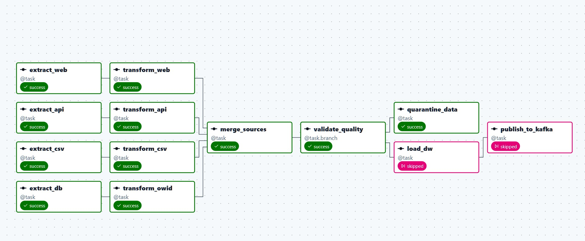

- **Cuatro extracciones independientes** (`extract_csv`, `extract_db`, `extract_api`, `extract_web`) que corren en paralelo, cada una con su transformación (13 tareas en total).
- `merge_sources` espera las cuatro transformaciones.
- `validate_quality` ejecuta Great Expectations y **decide la ruta** (es una tarea de ramificación): si la calidad es buena sigue a `load_dw`; si falla una regla crítica el flujo continúa por `quarantine_data` y `load_dw` queda omitido (`skipped`). En la imagen, un run con datos inválidos inyectados: el lote termina en cuarentena.
- `quarantine_data` identifica las filas inválidas del lote con su motivo, las guarda en `data/quarantine/<run_id>/`, registra el lote en `dw.quarantine_log`, deja la ejecución con estado `quarantined` en `dw.etl_run_log` y emite una alerta en el log de la tarea. El Data Warehouse no cambia.
- `load_dw` carga el Data Warehouse y registra la ejecución.
- `publish_to_kafka` (solo después de una carga exitosa) lee de `dw.v_prediction_features` el último día de cada ciudad y publica un evento por ciudad en el tópico `air_quality_features`. Parámetro `kafka_dias` (1 por defecto) para publicar más días.
- Reintentos: 2 por tarea con 2 minutos de espera. Un fallo que no es temporal, como un archivo CSV dañado, agota los reintentos, falla la tarea y requiere intervención. Un `on_failure_callback` registra cualquier fallo en `dw.etl_run_log`.
- Los datos pasan entre tareas como archivos parquet en `data/staging/<run_id>/`, no por XCom.
- Parámetro `prueba_falla_calidad` (falso por defecto): al activarlo, `merge_sources` agrega filas inválidas para demostrar la cuarentena del lote.

Una ejecución exitosa:

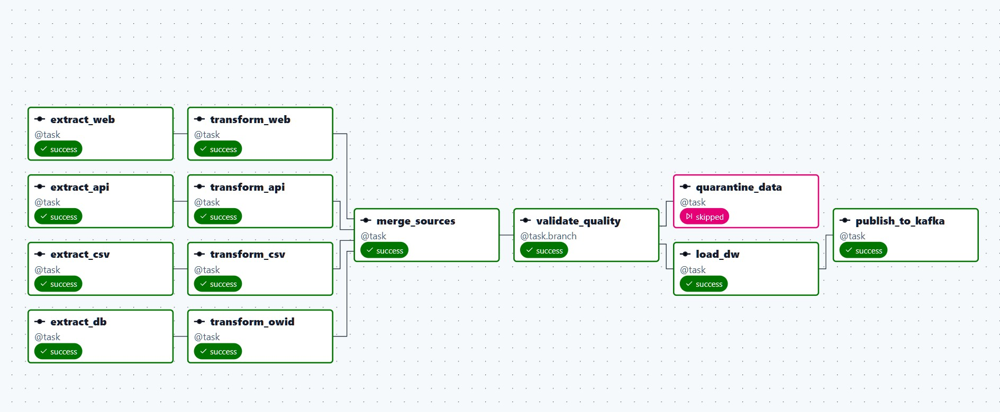

## 8. Validación con Great Expectations

Las suites se definen en `src/quality.py` y se versionan como JSON en `gx/expectations/`. Cada expectativa es **crítica** (envía el lote a cuarentena y bloquea la carga) o **advertencia** (solo se registra). El resultado de cada expectativa se guarda en `dw.dq_validation_log` y se generan Data Docs en `gx/uncommitted/data_docs/`.

| Suite | Datos | Críticas | Advertencias | Reglas principales |
|---|---|---|---|---|
| `suite_hechos_calidad_aire` | dataset enriquecido | 14 | 3 | filas entre 100 mil y 5 millones; claves no nulas; fuente válida; unicidad de `(ubicación, fecha, fuente)`; humedad y nubosidad 0-100; temperatura -90 a 60; viento, presión, PM2.5, PM10 e índice EPA en rangos físicos; frescura del último día; nulos de PM2.5 y temperatura |
| `suite_ubicaciones` | ubicaciones únicas | 5 | 1 | clave única; nombre no nulo; latitud y longitud válidas; ISO3 con formato `AAA`; ISO3 con indicadores |
| `suite_indicadores_pais` | indicadores por país | 4 | 2 | entre 150 y 260 países; ISO3 único y no nulo; población positiva; rango de CO₂ per cápita; cobertura de PIB |
| `suite_web_pm25` | tabla extraída de la web | 5 | 1 | entre 150 y 260 países; ISO3 no nulo, único y con formato `AAA`; PM2.5 anual entre 0 y 100; años de vida perdidos entre 0 y 10 (advertencia) |

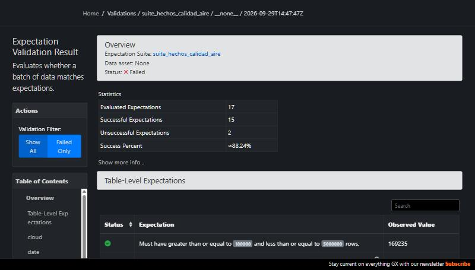

La imagen muestra la validación de un run con datos inválidos: 15 de 17 expectativas cumplidas y dos críticas fallidas (humedad fuera de rango y filas repetidas), suficiente para enviar el lote a cuarentena.

## 9. Modelo dimensional y métrica publicada
Esquema estrella en el esquema `dw` (DDL en [`dwh_version/001_create_dw_schema.sql`](dwh_version/001_create_dw_schema.sql)):

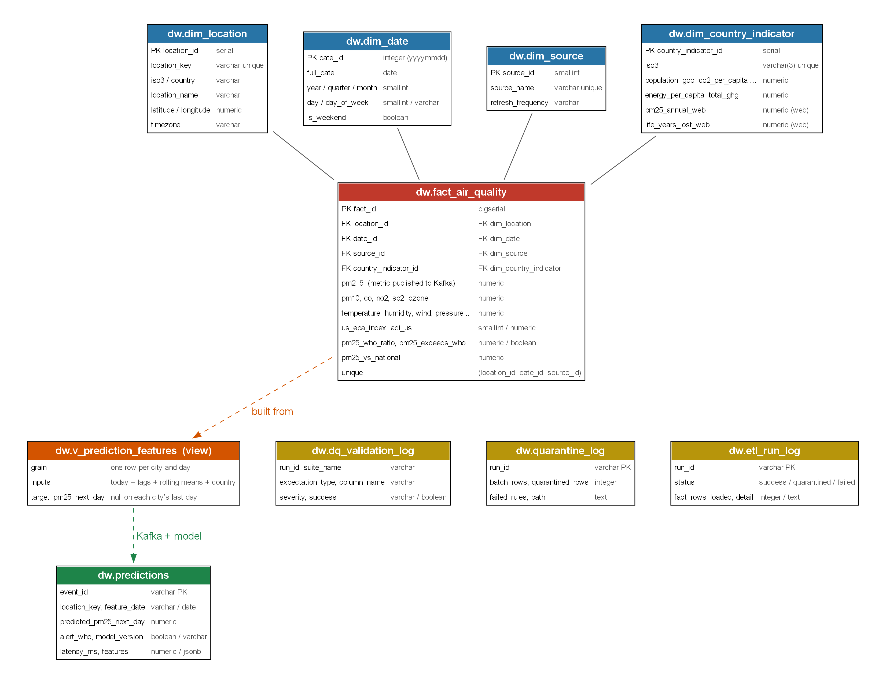

- **Hechos** `fact_air_quality`: una fila por ciudad, día y fuente, con clima, contaminantes, índice EPA, razón contra la guía OMS y bandera `pm25_exceeds_who`, más `pm25_vs_national` (lectura menos el PM2.5 anual del país).
- **Dimensiones**: `dim_location`, `dim_date`, `dim_source` y `dim_country_indicator` (una fila por país, con los indicadores de OWID y el PM2.5 anual y los años de vida perdidos de la web).
- **Auditoría**: `dq_validation_log` (resultados de validación), `quarantine_log` (lotes enviados a cuarentena) y `etl_run_log` (estado de cada ejecución: `success`, `quarantined` o `failed`).
- **Salida del modelo**: `dw.predictions` guarda cada predicción del consumidor (entradas, predicción, alerta, versión del modelo y latencia).

**Métrica publicada en Kafka.** `fact_air_quality.pm2_5`: PM2.5 diario en µg/m³ (el CSV trae una lectura puntual por día y la API un promedio diario; la columna `source` los distingue). La guía diaria de la OMS es 15 µg/m³.
**Grano.** Un hecho por ciudad, día y fuente (clave única `(location_id, date_id, source_id)`).
**Dataset de predicción.** La vista `dw.v_prediction_features` (una fila por ciudad y día) combina los hechos con las dimensiones y calcula, **solo con días anteriores**, los rezagos (1, 2, 3 y 7 días), las medias móviles (3, 7 y 30 días), la desviación de 7 días, las variaciones de temperatura, presión y viento y el cociente de hoy contra la media de 7 días. El objetivo (`target_pm25_next_day`) es el PM2.5 del día siguiente y queda nulo en el último día de cada ciudad: esas filas son las que se publican.
**Repeticiones del DAG.** La carga es idempotente: los hechos del CSV usan `ON CONFLICT DO NOTHING`, los de la API `DO UPDATE`, y repetir una ejecución no duplica datos. Las predicciones usan `event_id` como clave primaria y `ON CONFLICT DO NOTHING`.

## 10. Eventos de Kafka: productor y consumidor
- **Tópico:** `air_quality_features` (3 particiones, 1 réplica). **Clave del mensaje:** `location_key`, así que los eventos de una ciudad llegan en orden a la misma partición. **Formato:** JSON.
- **Productor** ([`src/kafka_producer.py`](src/kafka_producer.py)): lee de `dw.v_prediction_features` los últimos días de cada ciudad y publica un evento por fila con una pausa corta (`producer_delay_seconds`, 0.05 s). Se ejecuta como tarea del DAG (`publish_to_kafka`) y también por separado: `python -m src.kafka_producer --dias 3`. **No incluye el objetivo** (evitaría fuga de datos) y valida la entrega de cada mensaje.
- **Consumidor** ([`src/kafka_consumer.py`](src/kafka_consumer.py)): carga el modelo serializado **una sola vez**, valida cada mensaje (estructura, tipos, rangos, fecha y que no traiga el objetivo), descarta los inválidos con su motivo, predice **una vez por mensaje válido** y guarda el resultado en `dw.predictions`. No reentrena.

**Estructura del evento** (campos de [`src/ml_contract.py`](src/ml_contract.py)):

| Grupo | Campos |
|---|---|
| Identificación | `event_id` (UUID), `event_ts` (UTC, ISO 8601), `location_key`, `location_name`, `country`, `iso3`, `latitude`, `longitude`, `feature_date` |
| Aire de hoy | `pm2_5`, `pm10`, `co`, `no2`, `so2`, `ozone` |
| Clima de hoy | `temperature_celsius`, `humidity`, `wind_kph`, `pressure_mb`, `precip_mm`, `cloud`, `uv_index` |
| Historia (solo días anteriores) | `pm25_lag1`, `pm25_lag2`, `pm25_lag3`, `pm25_lag7`, `pm25_mean_3d`, `pm25_mean_7d`, `pm25_std_7d`, `pm25_mean_30d`, `ratio_today_7d`, `delta_temp`, `delta_pressure`, `delta_wind` |
| Calendario | `month`, `day_of_week` |
| País (base de datos y web) | `co2_per_capita`, `gdp_per_capita`, `energy_per_capita`, `pm25_annual_web` |

Los valores faltantes viajan como `null`; el modelo los maneja de forma nativa. `pm2_5`, la ubicación, `iso3` y la fecha son obligatorios.

```json
{"event_id": "28a5fa15-...", "event_ts": "2026-11-18T15:39:57.919Z", "location_key": "AUS|canberra", "feature_date": "2026-11-18",
 "pm2_5": 5.55, "pm25_lag1": 3.42, "pm25_mean_7d": 4.15, "temperature_celsius": 17.4, "co2_per_capita": 14.48, "iso3": "AUS", "...": "..."}
```

**Inferencia por mensaje.** `predecir_evento` arma una fila con las columnas del contrato y llama a `modelo.predict`; el resultado se convierte en el PM2.5 previsto, una alerta si supera el margen (13 µg/m³) y la latencia medida (≈ 20-35 ms).

## 11. Modelo de aprendizaje automático
- **Objetivo:** PM2.5 del día siguiente (µg/m³) en cada ciudad. **Por qué:** avisar con un día de anticipación qué ciudades superarán la guía de la OMS apoya el ODS 11.6 y es un caso operativo claro. **Regla de alerta:** el PM2.5 previsto supera 13 µg/m³, un margen de precaución bajo la guía de 15.
- **Variables:** las del evento (ver sección anterior). El objetivo nunca entra como variable.
- **Preprocesamiento:** los numéricos pasan tal cual y los nulos los maneja el modelo de forma nativa; el país (`iso3`) se codifica como categoría y un país no visto recibe -1 sin romper la inferencia.
- **Modelo** ([`src/ml_model.py`](src/ml_model.py)): predice el **cambio diario** (mañana menos hoy) y se lo suma al valor de hoy, promediando dos `HistGradientBoostingRegressor`: uno con pérdida de error absoluto (robusto a picos) y otro cuadrática (penaliza errores grandes). El preprocesamiento va dentro del objeto, que es lo que se serializa.
- **Evaluación sin fuga de datos:** división **por fecha** (entrenamiento con lo antiguo y prueba con los últimos 90 días, con un día de separación porque el objetivo es el día siguiente); los rezagos y medias solo usan días anteriores.
- **Artefactos:** `models/pm25_next_day_model.pkl` (modelo completo, `joblib`) y `models/model_metadata.json` (versión, variables, métricas y rango de fechas). Se versionan para que el consumidor funcione tras clonar el repositorio; se regeneran con `docker compose run --rm trainer`.

Resultados en el periodo de prueba (21,753 ciudad-día, 2026-08-20 a 2026-11-17):

| Modelo | MAE (µg/m³) | RMSE | R² | Alerta: precisión | Alerta: recall | Alerta: F1 |
|---|---|---|---|---|---|---|
| **Modelo** | **4.09** | **8.37** | **0.805** | 0.759 | 0.885 | 0.817 |
| Línea base: mañana = hoy | 4.39 | 9.21 | 0.763 | 0.738 | 0.885 | 0.805 |
| Línea base: media de 7 días | 5.53 | 10.71 | 0.680 | 0.688 | 0.823 | 0.749 |

La alerta se evalúa con la misma regla para todos (alertar cuando el valor supera 13; acierto si el valor real supera 15).

**Limitaciones.** La mejora sobre "mañana = hoy" es real pero moderada (−7 % en MAE, −9 % en RMSE): el PM2.5 cambia poco de un día a otro. Solo se predice un día. Las ciudades con tormentas de polvo (Riad, Pekín) tienen picos que el modelo subestima. Se mezclan lecturas puntuales (CSV) y promedios diarios (API). No se usa el pronóstico meteorológico del día siguiente, que mejoraría el modelo. Debe reentrenarse si cambian las fuentes. El análisis completo está en [`notebooks/modelo_prediccion.ipynb`](notebooks/modelo_prediccion.ipynb).

## 12. Informe estático
[`reports/generate_report.py`](reports/generate_report.py) consulta el modelo dimensional validado y genera [`reports/analytical_report.html`](reports/analytical_report.html), un archivo autocontenido (gráficos incrustados) con seis preguntas, su gráfico y un hallazgo calculado a partir de los datos: qué capitales tienen el peor aire, si el aire se relaciona con las emisiones y el ingreso, cómo se comparan las capitales con su país, la estacionalidad, el desempeño del modelo frente a las líneas base y el estado de la calidad de los datos y del flujo en tiempo real.

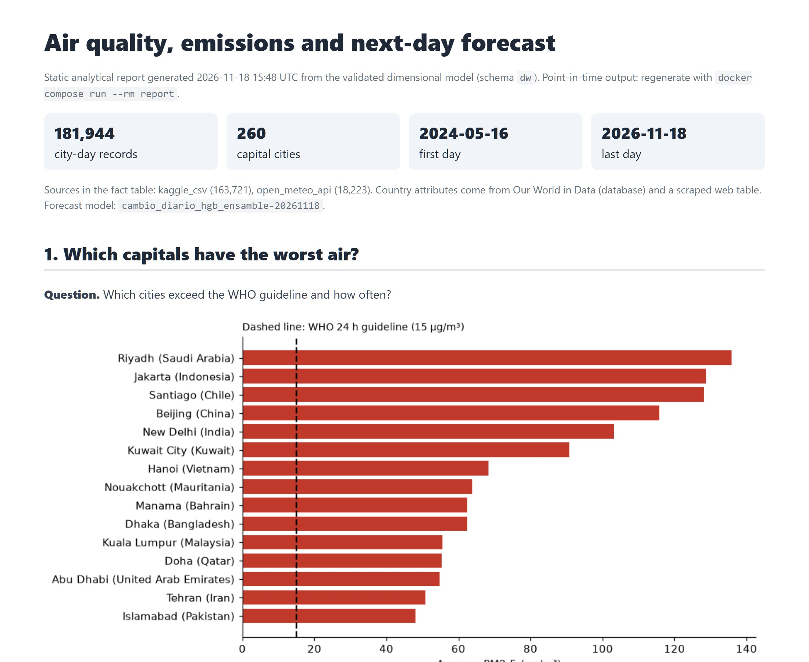

Es una foto en un momento dado: no se actualiza solo ni muestra mensajes de Kafka. Para regenerarlo:

```bash
docker compose run --rm report
```

## 13. Dashboard en tiempo real
[`dashboard_realtime/app.py`](dashboard_realtime/app.py) es una aplicación de Streamlit **distinta** del dashboard analítico y del informe. Un hilo ejecuta el consumidor de Kafka (`src/kafka_consumer.py`), aplica el modelo a cada evento y alimenta un estado en memoria; la pantalla se refresca cada segundo leyendo ese estado. **No consulta la base de datos para mostrar el flujo.**

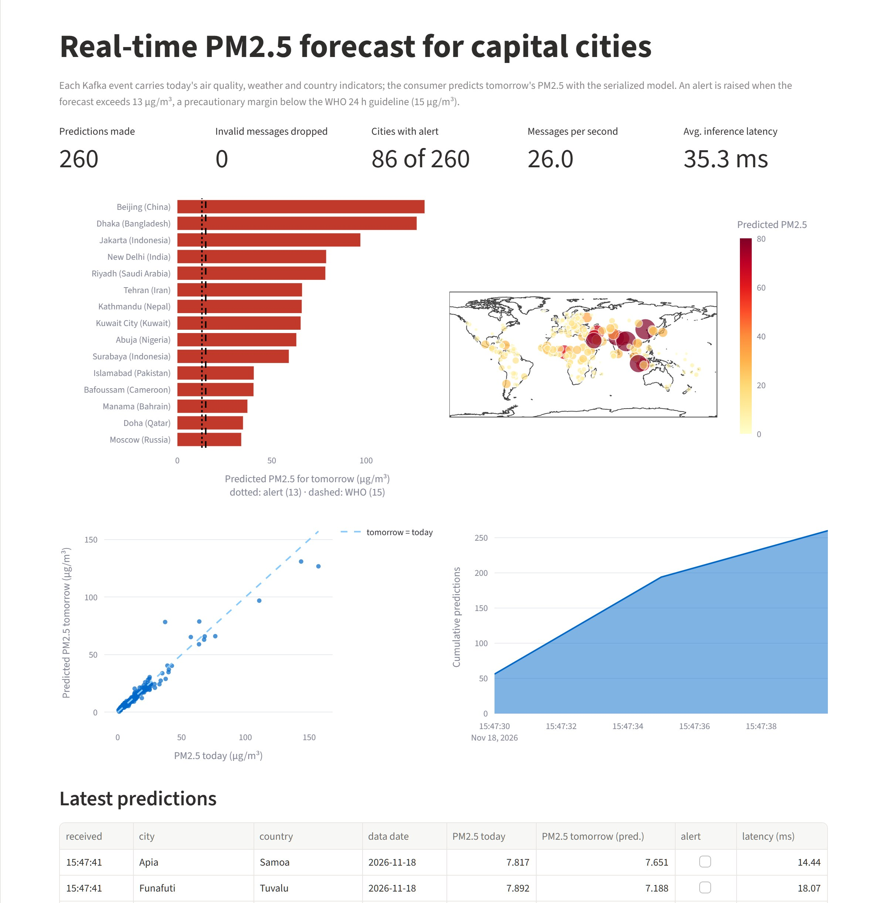

Muestra las predicciones hechas, los mensajes inválidos descartados, las ciudades en alerta, los mensajes por segundo y la latencia, el ranking y el mapa del PM2.5 previsto, la relación entre hoy y mañana y las últimas predicciones. Disponible en http://localhost:8502.

## 14. Valor analítico y operativo
| | Camino analítico | Camino operativo |
|---|---|---|
| **Pregunta** | ¿Qué ciudades tienen peor aire, por qué y cómo evoluciona? | ¿Qué ciudades tendrán mal aire mañana? |
| **Datos** | Modelo dimensional completo, validado | Un evento por ciudad con las variables de hoy |
| **Salida** | Informe estático y dashboard analítico | Predicción y alerta por cada mensaje, en tiempo real |
| **Quién decide** | Quien define políticas de calidad del aire (ODS 11.6): dónde actuar y con qué prioridad | Quien opera alertas: avisar a la población o activar medidas con un día de anticipación |
| **Valor** | Entender causas, comparar ciudades y países, medir tendencias | Anticipar y reaccionar a tiempo |

**La misma arquitectura sirve a ambos:** la validación de calidad protege las dos salidas (ningún dato inválido llega al almacén ni se publica en Kafka), y el modelo dimensional es la única fuente de verdad: el informe lo consulta completo y el productor publica de él lo más reciente.

## 15. Visualizaciones e insights

El dashboard analítico ([`dashboard/app.py`](dashboard/app.py), puerto 8501) solo consulta el esquema `dw`, es decir, datos ya validados.

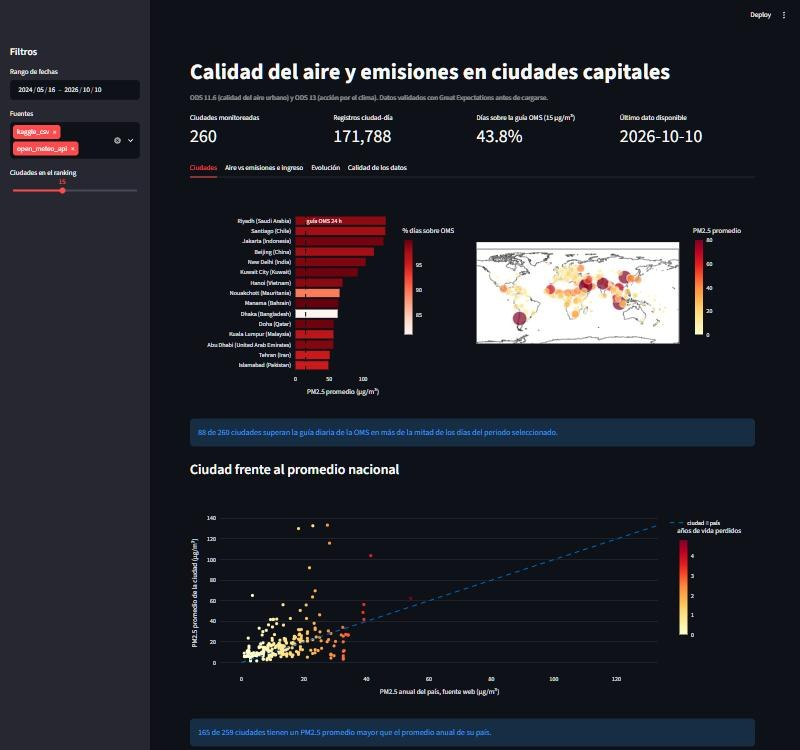

Con los datos cargados al 2026-10-10 (171,788 registros ciudad-día):

- 43.8% de los registros superan la guía diaria de la OMS para PM2.5, y 88 de 260 ciudades la superan en más de la mitad de los días. Riad, Santiago, Yakarta, Pekín y Nueva Delhi encabezan el ranking.
- La correlación de Spearman entre PM2.5 y CO₂ per cápita del país es -0.08 (187 países) y con el PIB per cápita es -0.22 (159 países): la contaminación urbana de las capitales casi no se explica por las emisiones per cápita del país y solo se asocia débilmente con un menor ingreso.
- Con la fuente web, 165 de 259 ciudades tienen un PM2.5 promedio mayor que el promedio anual de su país: las capitales concentran más contaminación que el promedio nacional. La gráfica "Ciudad frente al promedio nacional" colorea cada ciudad por los años de vida perdidos de su país.
- La serie mensual muestra un máximo a inicios de 2025 y la continuación con datos de la API.

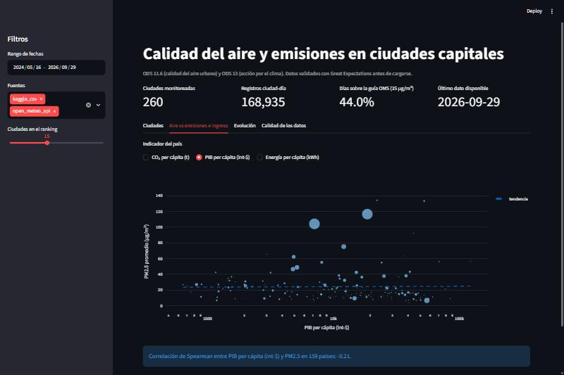

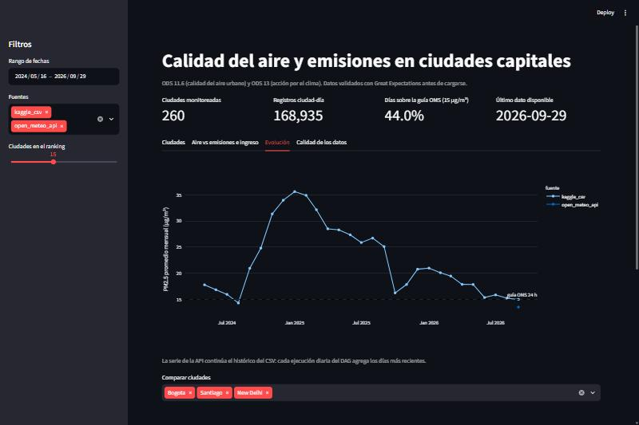

La pestaña **Calidad de los datos** muestra el estado de la última ejecución, el resumen de la última validación aprobada y el historial, incluida la ejecución enviada a cuarentena en la demostración y la tabla de lotes en cuarentena:

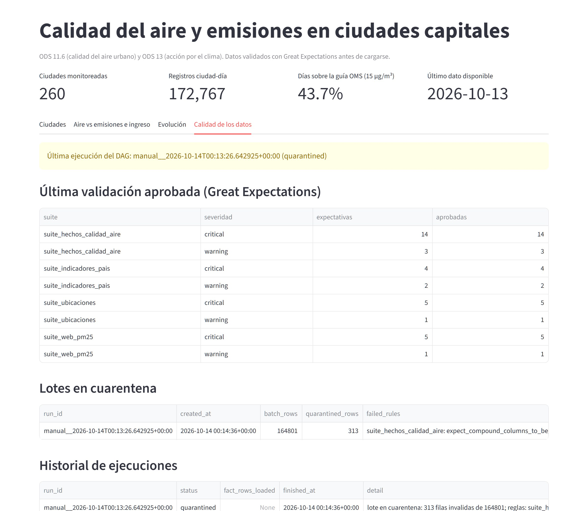

## 16. Puesta en marcha

### Requisitos

- Docker Desktop con Docker Compose v2 y al menos 8 GB de RAM disponibles para Docker (Airflow, Kafka y los dashboards corren a la vez).
- Puertos libres: 8080 (Airflow), 8501 (dashboard analítico), 8502 (dashboard en tiempo real), 9094 (Kafka) y 5433 (Data Warehouse).
- Conexión a internet (imágenes de Docker y API).

### Pasos

```bash
git clone https://github.com/yurani-duque/etl-airflow-calidad-aire.git
cd etl-airflow-calidad-aire
cp .env.example .env
docker compose up -d --build
```

En Windows con PowerShell, el tercer comando es `copy .env.example .env`. La primera vez tarda varios minutos porque construye las imágenes. Los valores por defecto del `.env` apuntan al PostgreSQL local del compose, así que no hay que configurar nada.

Al arrancar, un servicio de preparación carga el dataset de emisiones en la base fuente y el scheduler queda activo.

1. Abrir Airflow en http://localhost:8080 (sin usuario ni contraseña).
2. Abrir el DAG `etl_calidad_aire` y pulsar **Trigger**. Tarda entre 2 y 5 minutos. El scheduler también puede lanzar una primera ejecución automática al arrancar; ambas son equivalentes porque la carga es idempotente.
3. Cuando el run termine en `success`, abrir el dashboard analítico en http://localhost:8501. La tarea `publish_to_kafka` ya dejó un evento por ciudad en el tópico.

**Camino operativo (Kafka y modelo):**

1. Abrir el dashboard en tiempo real en http://localhost:8502. Al abrirlo arranca el consumidor y procesa los eventos pendientes.
2. Para ver cómo se actualiza en vivo, publicar más eventos: `docker compose run --rm trainer python -m src.kafka_producer --dias 3` (el servicio `trainer` solo aporta la imagen con las dependencias).
3. Para reentrenar el modelo (opcional; el repositorio ya trae uno): `docker compose run --rm trainer`.
4. Para generar el informe estático: `docker compose run --rm report`; se escribe en `reports/analytical_report.html`.

Los pasos 3 y 4 requieren que el DAG haya cargado datos al menos una vez (crean y consultan `dw.v_prediction_features`).

Verificar la carga desde la terminal:

```bash
docker compose exec warehouse psql -U dwh -d dwh -c "select count(*) from dw.fact_air_quality"
```

### Demostrar la cuarentena por calidad

En Airflow, **Trigger DAG w/ config** y activar `prueba_falla_calidad` (o ejecutar el comando de abajo). La tarea `validate_quality` detecta las reglas críticas fallidas y envía el lote a `quarantine_data`; `load_dw` queda omitido y el Data Warehouse no cambia. Para revisar el resultado: la pestaña **Calidad de los datos** del dashboard muestra el lote en cuarentena, y la carpeta `data/quarantine/<run_id>/` contiene `filas_cuarentena.parquet` (cada fila con su motivo) y `reporte.json`.

```bash
docker compose exec airflow-scheduler airflow dags trigger etl_calidad_aire --conf '{"prueba_falla_calidad": true}'
```

### Usar Supabase u otro PostgreSQL

Reemplazar en `.env` los valores `DB_HOST`, `DB_PORT`, `DB_NAME`, `DB_USER` y `DB_PASSWORD` por las credenciales del servidor y volver a levantar el compose. El pipeline crea los esquemas `source` y `dw` automáticamente. El `.env` está en `.gitignore` y nunca se sube.

### Conectar Power BI (opcional)

Obtener datos, PostgreSQL, servidor `localhost:5433`, base `dwh`, usuario `dwh` y contraseña `dwh_password`. Importar las tablas del esquema `dw`.

### Apagar

```bash
docker compose down        # conserva los datos
docker compose down -v     # borra también los volúmenes
```

## 17. Pruebas

Pruebas de transformaciones (incluida la extracción y limpieza de la tabla web con HTML de ejemplo), ubicaciones y extracción incremental (Python 3.14 con `uv`):

```bash
uv sync
uv run pytest
```

Pruebas de las suites de Great Expectations (incluye datos corruptos que deben bloquear la carga y la identificación de filas para cuarentena) y del DAG, dentro del contenedor:

```bash
docker compose --profile test run --rm tests
```

Pruebas del contrato de eventos, el productor, la división por fecha, la inferencia por mensaje y el descarte de mensajes inválidos:

```bash
docker compose --profile test run --rm streaming-tests
```

## 18. Estructura del repositorio

```
config/          configuración (config.yaml) y tabla de países a ISO3
dags/            DAG de Airflow
src/             extracción, transformación, unión, validación, carga, cuarentena, modelo, productor y consumidor
utils/           conexión, configuración y logging
dwh_version/     DDL del Data Warehouse
gx/              configuración y expectativas de Great Expectations
dashboard/       dashboard analítico (Streamlit)
dashboard_realtime/  dashboard en tiempo real alimentado por el consumidor de Kafka
models/          modelo serializado (.pkl) y metadatos
reports/         informe estático (generador y HTML)
notebooks/       EDA de las entregas 1 y 2 y cuaderno del modelo de predicción
test/            pruebas unitarias
docs/            documento técnico, diagramas y capturas
data/raw/        copias comprimidas de los datos de origen
data/quarantine/ filas inválidas de los lotes enviados a cuarentena (se genera al ejecutar)
docker/          Dockerfiles de Airflow, del dashboard analítico y de streaming
docker-compose.yml, requirements-*.txt, .env.example
```

## 19. Decisiones clave

- **Airflow en Docker Compose con LocalExecutor**: un solo comando levanta el proyecto y es reproducible en cualquier equipo; no se necesita Celery ni Redis para este volumen.
- **PostgreSQL parametrizado por variables de entorno**: por defecto un contenedor local, y Supabase u otro servidor cambiando solo el `.env`.
- **Great Expectations dentro del DAG y con severidades**: reglas críticas envían el lote a cuarentena y bloquean la carga; las advertencias solo informan.
- **Cuarentena del lote completo**: si falla una regla crítica no se carga nada de ese lote, porque mezclar filas buenas y malas podría dejar el almacén inconsistente; las filas inválidas quedan identificadas con su motivo para corregirlas y reprocesar.
- **Extracción incremental de la API**: se piden solo los días posteriores al último cargado, lo que reduce las peticiones y respeta los límites.
- **Ubicación canónica y tabla de países**: resuelve nombres en otros idiomas y coordenadas cambiantes en el origen.
- **Scraping acotado a una tabla estable**: se extrae una sola tabla de una página con licencia abierta, con `User-Agent` propio y tiempo máximo de espera; si la estructura cambia, la tarea falla en lugar de cargar datos incorrectos.
- **Datos comprimidos en el repositorio** (17 MB): para que el proyecto corra sin descargas manuales ni cuentas de terceros.
- **Kafka en modo KRaft de un solo nodo**: cumple el caso de uso sin Zookeeper ni más contenedores; el flujo se simula leyendo la tabla de hechos.
- **Un solo contrato de datos** (`src/ml_contract.py`) para entrenamiento, productor y consumidor: evita que cada pieza interprete las columnas distinto.
- **Dataset de predicción como vista SQL**: el entrenamiento y el productor leen exactamente las mismas columnas del modelo dimensional.
- **Predecir el cambio diario y comparar siempre contra "mañana = hoy"**: la línea base es fuerte; el modelo solo aporta si la supera.
- **El consumidor valida antes de predecir**: un mensaje inválido se descarta y se cuenta, no se predice.
- **Modelo versionado en el repositorio** (3.6 MB): el consumidor funciona tras clonar, y la imagen de streaming fija las versiones para que el `.pkl` siempre cargue.
- **Hilos de OpenMP limitados** (OMP_NUM_THREADS=4, espera pasiva): con muchos núcleos visibles, cada contenedor con scikit-learn lanzaba un hilo por núcleo y, al convivir el dashboard, el entrenamiento y las pruebas, todo se volvía decenas de veces más lento (las pruebas pasaron de 274 s a 7 s). La inferencia de un solo mensaje usa un hilo.
- **Python 3.12 en los contenedores**: Great Expectations 1.x aún no soporta Python 3.14, que se usa en el entorno local con `uv`.

## 20. Limitaciones
- La mejora del modelo sobre la línea base de persistencia es moderada; el horizonte es de un día.
- La simulación del flujo publica datos de la tabla de hechos con una pausa corta; no es captura de cambios (CDC) ni una plataforma de eventos de producción (un solo broker, una réplica).
- La API gratuita tiene cuotas y es de uso no comercial; el dato web es anual y depende de una página de terceros.
- El plan gratuito de Supabase se pausa por inactividad; por defecto el proyecto usa el PostgreSQL local del compose.
- El consumidor guarda las predicciones y procesa de uno en uno: suficiente para ~260 ciudades por día, no para un volumen alto.

## 21. Solución de problemas

| Síntoma | Causa y solución |
|---|---|
| `port is already allocated` | otro programa usa 8080, 8501 o 5433; cerrarlo o cambiar el puerto en `docker-compose.yml` |
| El DAG no aparece | esperar unos 30 segundos y refrescar; ver `docker compose logs airflow-dag-processor` |
| `extract_api` falla con 429 | límite de la API gratuita; reintentar en unos minutos |
| `extract_web` falla | la página no responde o cambió la estructura de la tabla; Airflow reintenta dos veces. Si persiste, revisar la URL en `config/config.yaml` y el mensaje del log |
| El dashboard muestra errores de conexión | esperar a que `warehouse` esté saludable (`docker compose ps`) y correr el DAG al menos una vez |
| `no matching manifest` al construir | Docker Desktop debe usar contenedores de Linux |
| El dashboard en tiempo real dice "Waiting for events" | el tópico está vacío o el consumidor aún se une al grupo (unos segundos); publicar con `python -m src.kafka_producer` |
| `publish_to_kafka` falla | Kafka aún no está saludable (`docker compose ps`); Airflow reintenta dos veces |
| El trainer o el informe dicen que no existe `v_prediction_features` | correr el DAG al menos una vez para crear el esquema `dw` |
| `no existe models/pm25_next_day_model.pkl` | entrenar con `docker compose run --rm trainer` |

## 22. Licencias y atribución de datos

- Datos meteorológicos y de calidad del aire: [Open-Meteo](https://open-meteo.com/) (CC BY 4.0), uso no comercial.
- Emisiones y economía: [Our World in Data, CO₂ and Greenhouse Gas Emissions](https://github.com/owid/co2-data) (CC BY 4.0).
- PM2.5 anual por país y años de vida perdidos: [Wikipedia, List of countries by air pollution](https://en.wikipedia.org/wiki/List_of_countries_by_air_pollution) (CC BY-SA 4.0), que a su vez cita datos del Banco Mundial y de la OMS.
- Lecturas históricas: [World Weather Repository, Kaggle](https://www.kaggle.com/datasets/nelgiriyewithana/global-weather-repository), publicado por Nidula Elgiriyewithana.
- Guía de calidad del aire de la OMS (2021) para el umbral de PM2.5 de 15 µg/m³ en 24 horas.

